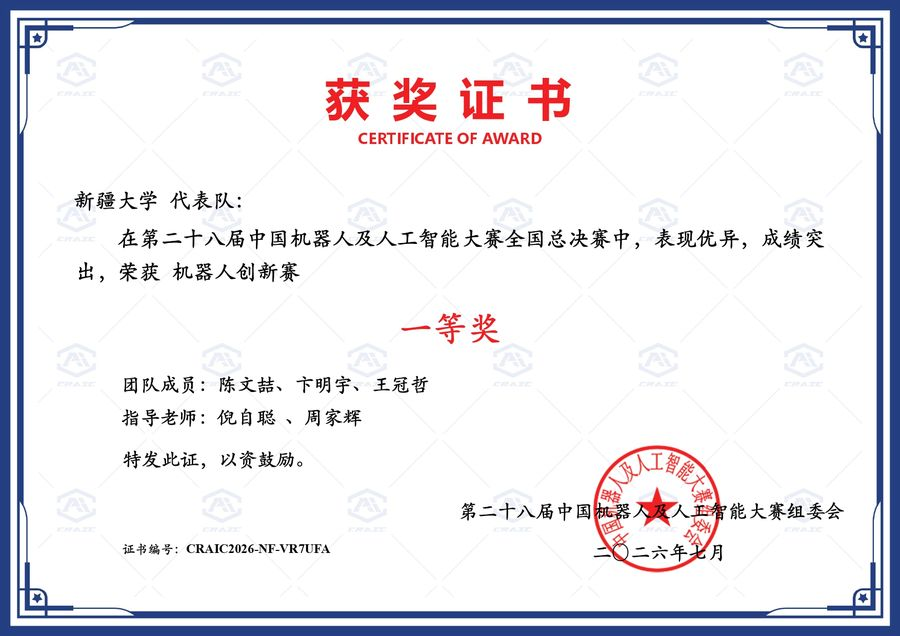
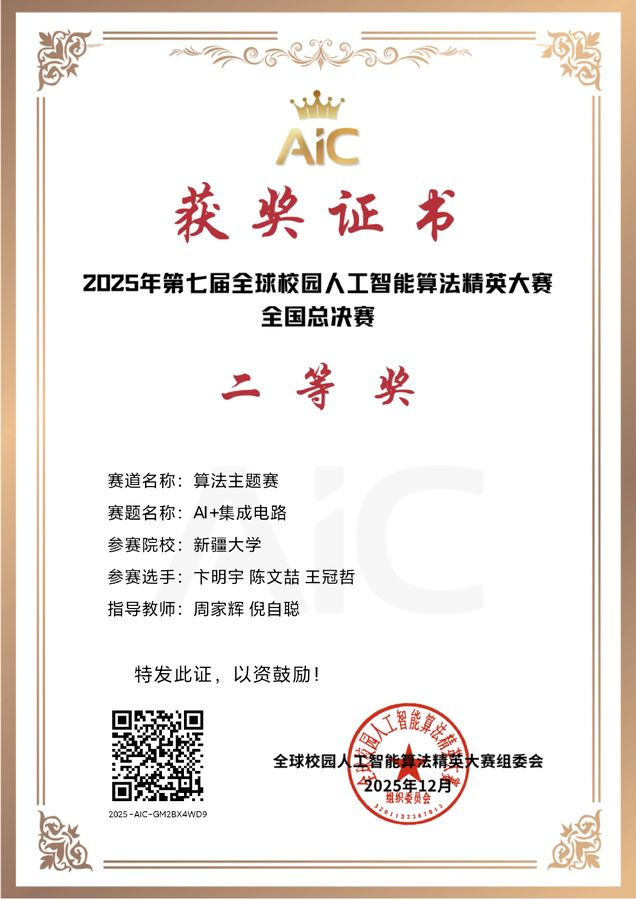
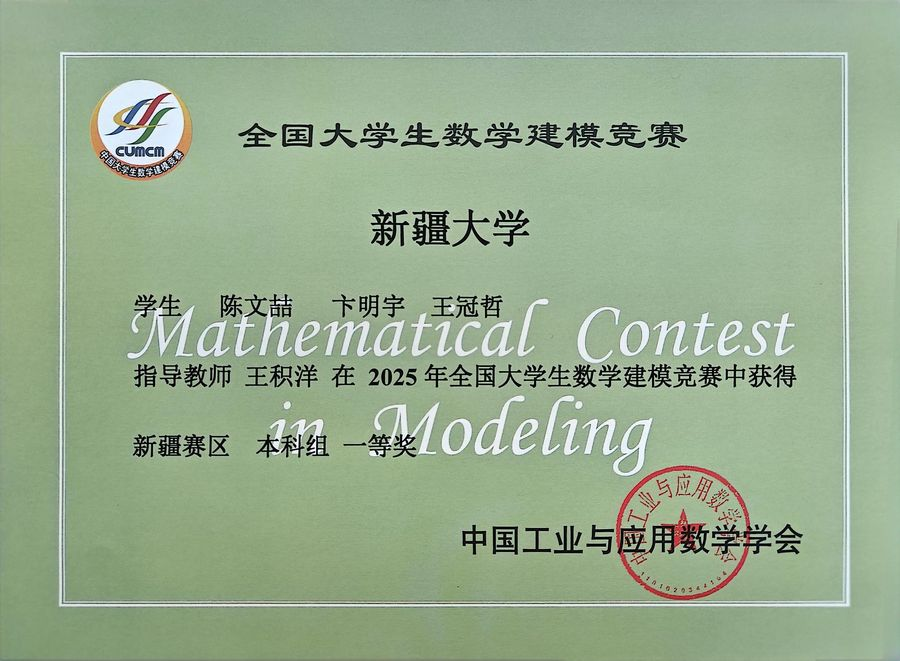
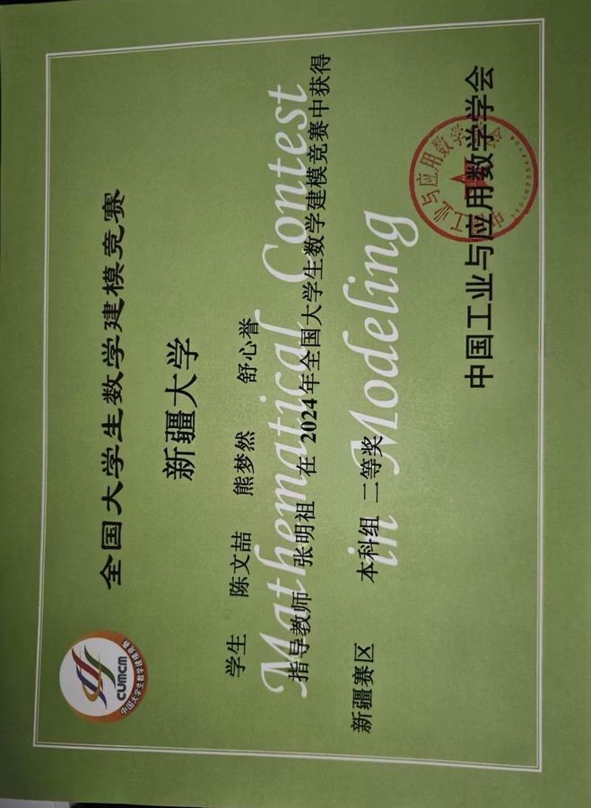

# 获奖证书与成果存档 · Certificates & Achievements

> **陈文喆（Chen Wenzhe）** · 新疆大学 软件工程（211 / 双一流）· 2027 届
> 本仓库用于集中存档本人竞赛获奖证书、论文录用与出版证明材料，供招聘方、评审老师核验。

---

## 目录结构

```
certificates/
├── awards/                      # 竞赛获奖证书
│   ├── math-modeling/           #   数学建模类
│   ├── robotics-ai/             #   机器人及人工智能类
│   └── ai-algorithm/            #   AI 算法类
└── publications/                # 论文录用 / 出版证明
    ├── ICIC2026-Springer/       #   ICIC 2026（Springer，EI 收录）
    ├── EI-CITSC/                #   EI 会议 · CITSC
    └── EI-ABCM/                 #   EI 会议 · ABCM
```

每个目录下的 `thumbs/` 存放压缩预览图，便于快速浏览；原图在同级目录。

---

## 一、竞赛荣誉 Awards

| 年份 | 竞赛名称 | 奖项 | 级别 | 证书 |
|:---:|---|---|:---:|:---:|
| 2026 | 中国机器人及人工智能大赛（CRAIC） | 国家**一等奖** | 国家级 | [查看](awards/robotics-ai/2026-CRAIC-中国机器人及人工智能大赛-国家一等奖.jpg) |
| 2025 | 全球人工智能算法精英大赛（AIC） | 国家**二等奖** | 国家级 | [查看](awards/ai-algorithm/2025-AIC-全球人工智能算法精英大赛-国家二等奖.jpg) |
| 2025 | 全国大学生数学建模竞赛（CUMCM） | 新疆赛区本科组**一等奖** | 省级 | [查看](awards/math-modeling/2025-CUMCM-全国大学生数学建模竞赛-新疆赛区本科组-一等奖.jpg) |
| 2024 | 全国大学生数学建模竞赛（CUMCM） | 新疆赛区本科组**二等奖** | 省级 | [查看](awards/math-modeling/2024-CUMCM-全国大学生数学建模竞赛-新疆赛区本科组-二等奖.jpg) |

### 证书预览

<table>
<tr>
<td width="50%" align="center">
<b>2026 中国机器人及人工智能大赛 · 国家一等奖</b><br>

</td>
<td width="50%" align="center">
<b>2025 全球人工智能算法精英大赛 · 国家二等奖</b><br>

</td>
</tr>
<tr>
<td width="50%" align="center">
<b>2025 全国大学生数学建模竞赛 · 新疆赛区一等奖</b><br>

</td>
<td width="50%" align="center">
<b>2024 全国大学生数学建模竞赛 · 新疆赛区二等奖</b><br>

</td>
</tr>
</table>

---

## 二、论文成果 Publications

### 1. ICIC 2026（Springer 出版 · EI 收录）

- **DOI**：[10.1007/978-981-92-3485-1_23](https://doi.org/10.1007/978-981-92-3485-1_23)
- **作者身份**：第一作者

| 材料 | 说明 |
|---|---|
| [论文首页](publications/ICIC2026-Springer/01-论文首页.jpg) | 标题、作者与摘要 |
| [出版页面与 DOI](publications/ICIC2026-Springer/02-出版页面与DOI.jpg) | Springer 官方出版页截图 |
| [期刊封面](publications/ICIC2026-Springer/03-期刊封面.jpg) | 论文集封面 |
| [目录页](publications/ICIC2026-Springer/04-目录页.jpg) | 收录页码索引 |

### 2. EI 会议 · CITSC

*A Multi-stage Modeling and Hierarchical Discrimination Framework for Composite Data Based on PCA Dimension Reduction and Enhanced K-means Clustering*

| 材料 | 说明 |
|---|---|
| [录用通知](publications/EI-CITSC/01-录用通知-Acceptance-Letter.jpg) | Acceptance Letter |
| [论文首页](publications/EI-CITSC/02-论文首页.jpg) | 标题、作者与摘要 |
| [EI 版权书](publications/EI-CITSC/03-EI版权书.jpg) | 版权转让协议 |

### 3. EI 会议 · ABCM

*A Time-Optimized Detection Algorithm Framework Based on Mixed-Effects Modeling and Entropy-Weighted TOPSIS for Multi-Source Feature Fusion*

| 材料 | 说明 |
|---|---|
| [录用通知](publications/EI-ABCM/01-录用通知-Acceptance-Letter.jpg) | Acceptance Letter |
| [论文首页](publications/EI-ABCM/02-论文首页.jpg) | 标题、作者与摘要 |
| [EI 版权书](publications/EI-ABCM/03-EI版权书.jpg) | 版权转让协议 |

---

## 说明

- 所有证书均为原件扫描 / 拍照，已做旋转校正与分辨率归一化处理。
- 为保护个人隐私，证书中仅保留必要的姓名、院校与获奖信息。
- 如对材料真实性有任何疑问，欢迎通过简历中的联系方式与本人核实。

*最后更新：2026-10*
